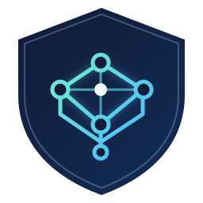

<p align="center">
  
</p>

<h1 align="center">MeshHome</h1>

<p align="center">An experimental Android client for reaching selected self-hosted services over Nord Meshnet.</p>

<p align="center">
  <a href="https://github.com/mohamedyassine-benmiled/MeshHome/actions/workflows/android.yml"></a>
  <a href="LICENSE"></a>
  
</p>

> **Experimental software — not production-ready.** MeshHome is independent and is not affiliated with or endorsed by Nord Security. It has received limited testing on one Android device. Security review, broad compatibility, automatic recovery, end-to-end service reachability, and battery consumption are not yet established. Do not rely on it as your only VPN or for high-risk use.

**Build status:** CI runs JVM tests, Android lint, and debug APK compilation without the native engine. It does not validate Meshnet connectivity or native release builds; see [native build verification](.github/workflows/native.yml) and [release and signing setup](docs/ANDROID_SIGNING.md). The live CI badge updates after the first workflow run.

## What it does

MeshHome creates an Android `VpnService` and lets you select which installed apps use the tunnel. You add DNS rules that map a domain or wildcard to a device in your Nord Meshnet account. For example, a rule for `*.example.org` can resolve `photos.example.org` to the selected peer's current Meshnet address while leaving other apps and ordinary internet routes outside this split tunnel.

The app supports Wi-Fi-only or Wi-Fi-and-cellular policy, optional home-Wi-Fi bypass, encrypted local credential storage, peer status, and a local DNS responder. It uses the public, pinned libtelio source as its native networking engine.

## Android quick start

1. **Build and install a native-enabled APK** (see [Build](#build)). A plain Gradle build without the native library is useful for UI/configuration work but cannot connect.
2. Follow the first-run setup guide, then open **Settings → Sign in with Nord token**. The guide can be reopened from the home screen. Generate a token through your Nord Account and enter it only in the app. MeshHome sends it over HTTPS to Nord's API; it never asks for your Nord password. The app registers this phone as a distinct Meshnet device.
3. Tap **Refresh Meshnet devices** and confirm your server or other target device appears.
4. Tap **Choose apps** and select only the apps that should use MeshHome. An empty or invalid selection will not create an unrestricted tunnel. Android allows only one active VPN per profile; connecting MeshHome replaces another VPN in that profile.
5. Under **Domain → Meshnet device**, add a domain rule and select its peer. An exact rule such as `service.example.org` applies only to that name. A wildcard such as `*.example.org` applies to subdomains (including deeper subdomains), but **not** to `example.org`; add a separate exact rule for the apex.
6. Choose **Wi-Fi only** or **all networks**. Optionally add a home Wi-Fi network for bypass. Home bypass restores Android's ordinary LAN routing/DNS; it is a convenience based on the visible Wi-Fi name, not secure network authentication.
7. For local DNS overrides, set Android **Private DNS** to **Off** or **Automatic** (not a strict provider hostname). Turn off the selected browser's own **Secure DNS/DoH** while testing so it uses Android's VPN DNS path.
8. Return home and tap the large **Connect** power button. Approve Android's VPN prompt and notification permission if requested. Android's key/VPN indicator should appear while the tunnel is active. The home screen shows live connection status. Check both the target-peer count and whether the intended service loads: a connected peer does not prove its web service is reachable.
9. Tap the same power button, now labeled **Disconnect**, or use the foreground notification's Disconnect action when finished.

### Service prerequisites

- The target peer must be online and permit incoming connections from this phone in its Meshnet settings.
- The web server/reverse proxy must listen on an address reachable through Meshnet, accept the requested hostname, present a valid TLS certificate, and allow the service port through its host/container firewall. DNS mapping does not change a URL's port or expose a service bound only to localhost.
- Test from an app selected in MeshHome. `adb shell`, `ping`, and the MeshHome app itself do not use the same selected-app tunnel path. ICMP is currently blocked by the client filter.
- DNS caches may persist after rule/network changes; clear the browser's cache or restart it when testing.

## What the status means

- **Meshnet running · N/M target peers connected** reports native peer state for configured targets. It does not test DNS, the service port, TLS, reverse-proxy routing, or the server application.
- A running Android VPN indicator means the VPN interface exists; it does not prove that a remote service answered.
- If DNS appears to fail, check strict Android Private DNS, browser Secure DNS/DoH, rule enablement, the selected device, and whether the app is in the allowlist.
- If DNS resolves but a URL times out, check that peer's incoming permission, Meshnet connectivity, host/container firewall, listening port, certificate, and reverse-proxy host rule.
- For Wi-Fi-only mode, MeshHome should pause rather than use cellular. Home bypass only applies when Android exposes the configured SSID.

See [phone testing](docs/PHONE_TESTING.md), [battery behavior and measurement](docs/BATTERY.md), [privacy notes](PRIVACY.md), and the version-specific [filter limitations](docs/0.3.2.md), [network-monitor fix](docs/0.3.5.md), and [disconnect behavior](docs/0.3.6.md).

## Build

### Requirements

- Android Studio or JDK 17+, Android SDK Platform 36, and Android Build Tools.
- Android 10 / API 29 or later; arm64-v8a is the tested native ABI.
- Rust toolchain, CMake, Git, and Android NDK r28+ to build the native engine.

### Android app

Windows PowerShell:

```powershell
.\gradlew.bat :app:assembleDebug
```

macOS/Linux:

```sh
./gradlew :app:assembleDebug
```

Without Android SDK, run the platform-independent core tests:

```sh
./gradlew -PcoreOnly :core:test
```

### Native engine

The repository does not contain prebuilt `.so` files or the fetched upstream checkout. Build the pinned native engine first; the script fetches the exact public libtelio revision and applies the recorded Android socketpair patch into ignored `vendor/libtelio/`:

```powershell
python scripts/build-native.py --ndk C:\path\to\android-ndk --abi arm64-v8a
.\gradlew.bat -PrequireNative :app:assembleDebug
```

On macOS/Linux, pass the local NDK path and use `./gradlew`. Workstation-specific convenience tooling is in `scripts/build-native-local.ps1`; other contributors should use the general script. Details and release gates are in [docs/NATIVE.md](docs/NATIVE.md).

Run checks:

```sh
./gradlew :core:test :app:testDebugUnitTest :app:lintDebug :app:assembleDebug :app:assembleDebugAndroidTest
```

To run the Android packet-pump instrumentation tests on a connected device:

```sh
./gradlew -PrequireNative :app:connectedDebugAndroidTest
```

For repeatable installs signed with your own persistent key, see [Android release signing](docs/ANDROID_SIGNING.md). Do not use an ordinary GitHub variable for passwords or the keystore; configure the documented repository Actions secrets.

Pushing a protected `vMAJOR.MINOR.PATCH` tag triggers the signed release workflow. It publishes a GitHub Release with the APK and source/license materials; a manual Actions run builds an artifact only. See [release and signing setup](docs/ANDROID_SIGNING.md).

No Nord token, private key, local SDK path, signing key, or account data belongs in source, build configuration, or issue reports. Automated API tests use synthetic credentials and fake responses.

## Architecture and current limitations

- Kotlin Android UI, foreground `VpnService`, app allowlisting, narrow routes to DNS/selected peers, explicit underlying-network socket binding, and local DNS A/AAAA overrides.
- Rust JNI bridge to pinned GPL-3.0-only libtelio. Direct peer discovery is disabled; transport is relay-only in this experimental integration.
- A small client-side TCP/UDP stateful filter replaces the separately distributed upstream firewall dependency: outbound connections are restricted to configured targets and unsolicited inbound traffic is blocked. This is not equivalent to the complete upstream firewall. ICMP, fragments, IPv6 extension headers, incoming phone-hosted services, and broad gateway routing are not supported. See [docs/0.3.2.md](docs/0.3.2.md).
- Apps with their own encrypted DNS can bypass local overrides. Non-matching DNS is forwarded as plaintext to the selected network's resolver or the configured upstream; that resolver/network can observe those queries.
- Home SSID matching can be spoofed, and background SSID visibility depends on Android permissions/location settings. MeshHome does not request GPS coordinates.
- No always-on/lockdown, boot auto-start, commercial VPN exit routing, file sharing, or general LAN gateway routing.
- Battery optimizations reduce app-level polling and refresh work, but real battery use has not been measured. Native timers, relay keepalives, traffic, radio quality, and retries still consume power.

MeshHome source is licensed under [GPL-3.0-only](LICENSE). Read [PLAN.md](PLAN.md) for design context, [PRIVACY.md](PRIVACY.md) for data handling, and [THIRD_PARTY_NOTICES.md](THIRD_PARTY_NOTICES.md) for dependency licensing. GPL corresponding-source and complete license-bundle obligations must be reviewed before distributing native builds. NordVPN/Meshnet are names of their respective owners; MeshHome is an independent project.
